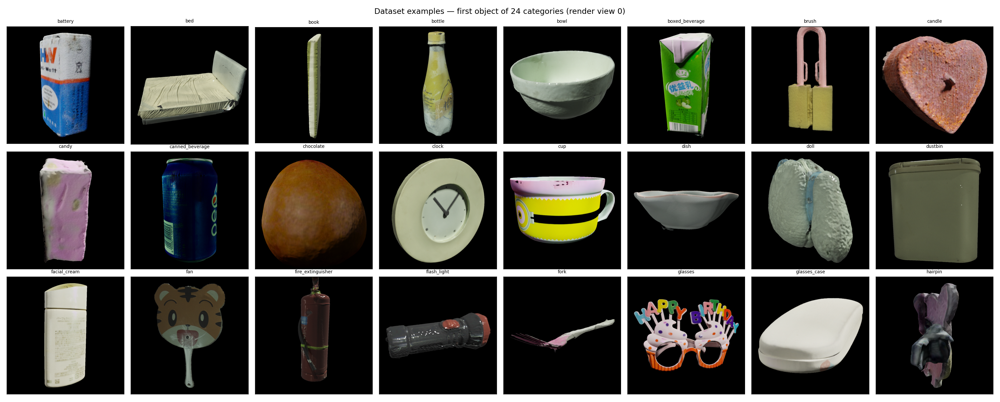
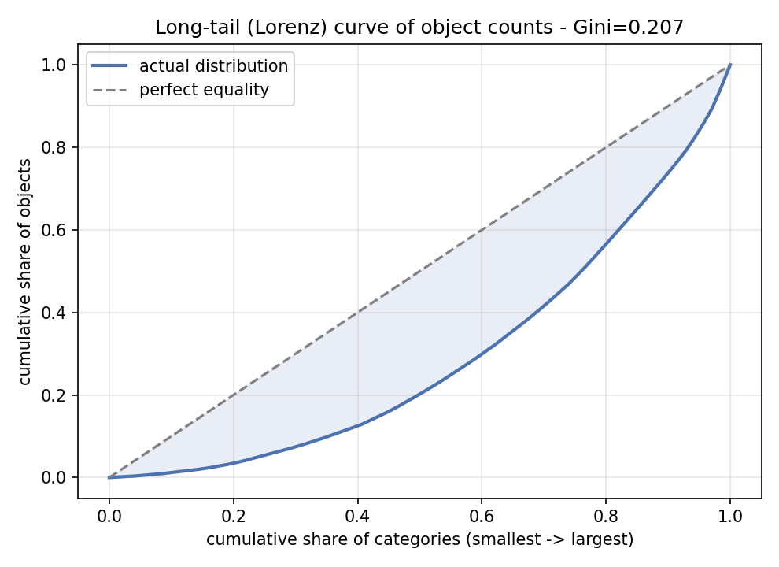
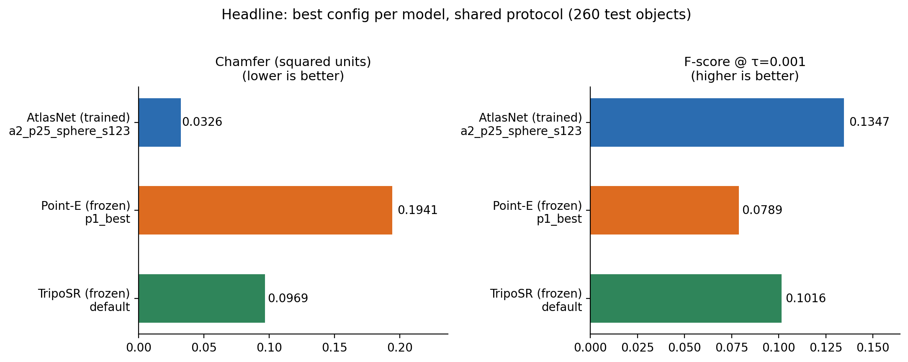
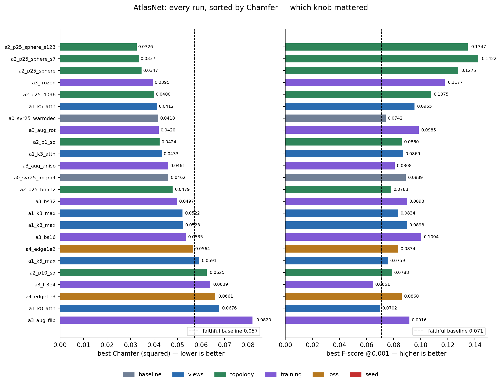
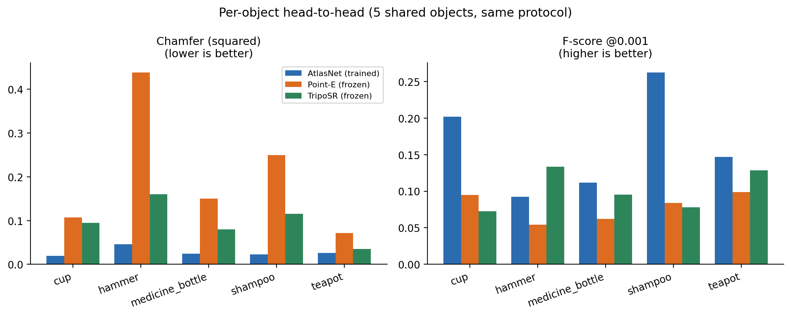
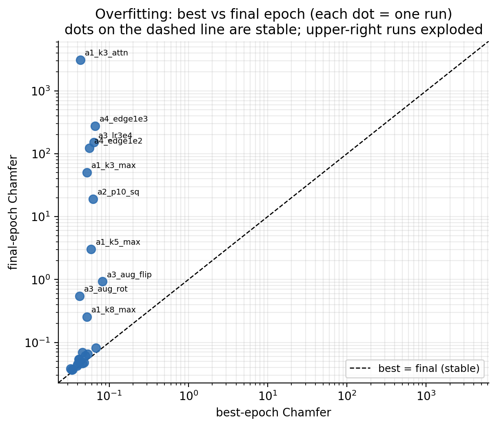
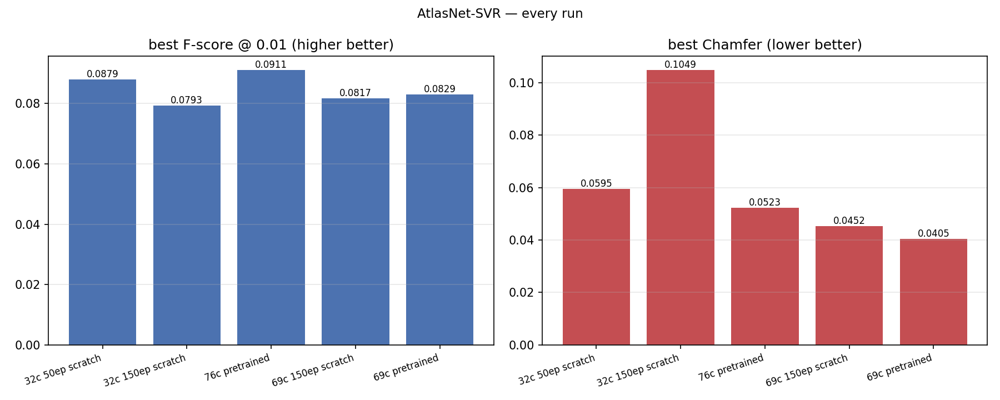

# Single-View 3D Reconstruction of Household Objects: AtlasNet, Point-E, and TripoSR

*A survey-style walkthrough of the `nesegemaa` branch: what we built, every
training run we conducted, and what moved the numbers — written so a newcomer
can follow each claim back to its evidence.*

**Scope.** This report covers exactly three tracks: **AtlasNet-SVR**
(trained here), **Point-E** (frozen, evaluated here), and **TripoSR**
(frozen, evaluated here). Nothing else.

> **Post-fix note.** Every number in this report was produced *after* the
> dataset point-cloud pairing fix (§5.2). Pre-fix numbers are kept only in
> `nesegemaa/*_prefix.csv` for the before/after table; do not mix them.

---

## Abstract

We study **single-view 3D reconstruction**: given one photograph of a household
object, produce its full 3D shape. Using a 76-category, 1694-object subset of
OmniObject3D (260 held-out test objects), we train AtlasNet-SVR from a faithful
reproduction through 24 recorded runs — multi-view encoders, decoder
capacity/topology, training regimes, warm-started weights, and a loss variant —
and we evaluate the frozen feed-forward models Point-E (12 configs) and
TripoSR (3 configs) under one shared protocol. Main findings (all post-fix):
(1) a SPHERE template beats the SQUARE baseline by ~25% Chamfer
(0.0347 vs 0.0462; winner 0.0326 with seed spread ±0.001) — the largest single
win; (2) multi-view helps modestly **only** with attention pooling (K=3–5,
best 0.0412) and *not* with max pooling; (3) a frozen ImageNet encoder beats
finetuning (0.0395 vs 0.0462) with the most stable tail; (4) best validation
epochs are scattered (2–50) while finals routinely explode (up to 71,000×), so
best-epoch snapshots are mandatory; (5) fixing a dataset-wide point-cloud
pairing bug (95% of clouds were named after the wrong object) materially moved
several conclusions — see §5.2. All runs, weight provenance, and per-object
numbers are committed alongside the code.

---

## 1. Introduction

**The task, in one paragraph.** A single photo of a mug shows one side of the
mug. Single-view 3D reconstruction asks a neural network to hallucinate the
rest: the back, the inside, the handle's far side. The network must combine
*what it sees* (pixels) with *what it knows* (a prior over object shapes
learned from thousands of examples). We work with everyday indoor objects —
cups, chairs, bottles, toys — photographed on turntables.

**What this document is.** Not a new-method paper: a *survey plus lab report*
over our three tracks. Section 2 maps the relevant literature; Sections 3–4
describe our data and methods; Section 5 flags two measurement hazards (weight
provenance, and the dataset bug fixed mid-project); Section 6 reports **every
run we conducted** (§6.1 all 24 AtlasNet trainings, §6.2 all 12 Point-E evals,
§6.3 all 3 TripoSR evals, §6.4 the head-to-head); Section 7 distills what
helped, what didn't, and what broke. Every number links to a committed artifact.

**Reading guide.** If you are new: read §§1–5, then the figures in §6. The
boxed notes explain each metric the first time it appears. Anything you cannot
reproduce from the paths given is a bug in this document — please file it.

---

## 2. Background and related work

Single-view reconstruction (SVR) splits roughly into **regressors** (predict
one shape directly — AtlasNet is ours), **implicit/continuous models**
(Occupancy Networks, DeepSDF — a shape is a function you can query anywhere),
and recently **generative priors** (diffusion models like Point-E that *sample*
plausible shapes conditioned on an image; feed-forward triplane models like
TripoSR).

> **Metric box — Chamfer + F-score.** Chamfer = average nearest-neighbor
> distance, prediction→truth plus truth→prediction; lower is better. F-score@τ
> counts points within tolerance τ, combining *precision* (did I invent fake
> surface?) and *recall* (did I cover the object?); higher is better.
> ⚠️ **Units matter here:** our training code's Chamfer kernel never takes a
> square root, so all our Chamfer numbers are in **squared-distance units**
> with F threshold **0.001** (≈ 0.0316 Euclidean on our unit-sphere
> normalization). Never compare them to Euclidean-unit numbers without
> converting.

Key references (one line each; full notes in `notes/`):

- **AtlasNet** (Groueix et al., CVPR 2018, arXiv:1802.05384) — deforms 2D
  patches (an "atlas") into a 3D surface via MLPs; Chamfer loss. Note: the
  paper's numbers are Chamfer×1000 on *unnormalized* clouds at F-threshold
  0.001 — a different protocol from ours.
- **Point-E** (Nichol et al., arXiv:2212.08751) — CLIP-conditioned point-cloud
  diffusion (1k base → 4k upsampled); our frozen baseline.
- **TripoSR** (Tochilkin et al., 2024) — feed-forward image→triplane→mesh; our
  second frozen baseline.
- **Occupancy Networks** (Mescheder et al., CVPR 2019, arXiv:1812.03872) —
  the continuous-output alternative to fixed-resolution shape codes.
- **Tatarchenko et al.** (CVPR 2019, arXiv:1905.03678) — do SVR nets even use
  the image, or just memorize category centroids? We ran their test (§7).
- **Long tail** (Cui et al., CVPR 2019; Kang et al., ICLR 2020) — 35 of our 76
  categories have <3 test objects; small-n numbers are noise, flagged `noisy`.
- **Transfer learning** (He et al., 2016; Huh et al., 2016) — why ImageNet
  encoders should help, and the story of §5.

---

## 3. Dataset

OmniObject3D house subset, 76 categories / **1694 objects** / 40,656 renders
(24 posed views each, 1024² RGBA + `transforms.json`), plus per-object point
clouds. Deterministic 70/15/15 split per category (seed 0) shared by every
model — test = **260 objects**. Integrity findings: one object (`laptop_002`,
9/24 views) dropped at prep time; 35 categories have <3 test objects
(`bed`, `plug`, `fork`, … — flagged `noisy` everywhere, never used for
claims). Category counts run 84 (`doll`) down to 2 (`plug`), median 20.

---

## 4. Methods

**AtlasNet-SVR** (image → surface, trained here): ImageNet ResNet-18 →
1024-d code → 25 patch MLPs (SQUARE default), Chamfer loss, 2500 train /
2500 eval points, 50 epochs per run. Every expected encoder tensor is asserted
by name and shape at build time (100/100), with file SHA logged — silent
partial weight loads raise instead of training on random features.
**Point-E** (frozen): `base40M-imagevec` (CLIP ViT-L/14 inside the package,
1024 pts, guidance sweep) → `upsample` (4096 RGB). **TripoSR** (frozen):
`stabilityai/TripoSR` → marching cubes (CPU shim, same algorithm) → sampled
points.

**Evaluation protocol (identical for all claims):** `splits.json` test lists,
input view `00.png` unless stated, UnitBall normalization (subtract mean,
divide by max radius), squared-distance units, F threshold 0.001, micro (all
samples) + macro (per-category) means. Reconstruction input is **images only**;
ground-truth clouds are scoring-only. Best-epoch weights are deployed, never
final (§7). Every run records exact weight provenance (file SHAs), and every
AtlasNet run is additionally scored on the **full 260-object test split**
(`qual_agg.json`), not just the training-time validation set.

---

## 5. Two measurement hazards (read before the results)

### 5.1 What "pretrained" meant here

Our encoder audit found the baseline was training from effectively random
image features: the vendored code called `resnet18(pretrained=False)` with
the ImageNet loader sitting unused beside it. We enabled it, and the build
now **asserts** all 100 non-classifier tensors matched by name and shape
(it already caught one real drift: 2017-era checkpoints lack
`num_batches_tracked` buffers, now explicitly scoped out as counters, not
weights). A 44.7 MB download, a one-flag fix.

### 5.2 The point-cloud pairing bug and its impact

The original downloader assumed OmniObject3D's per-category HDF5 files stored
clouds in sorted object-ID order; they do not. **1608 of 1695 clouds (95%)
were named after a different object of the same category** — the geometry was
intact, the names were shuffled. This corrupted *training targets* (AtlasNet
learned image → another object's shape) and *evaluation GT* (every score was
measured against the wrong cloud) for all runs before 2026-10-10.

The repair (`fix_point_cloud_names.py`) matches every local `.npy` by content
hash against the official named PLY archive; it is exact (1695/1695 matched),
idempotent, and new downloads now use the named archive. Everything in this
report was then retrained/re-evaluated; pre-fix numbers are archived in
`nesegemaa/ablation_*_prefix.csv`.

**What changed** (best validated Chamfer / F, before → after):

| run | before | after | note |
|---|---|---|---|
| A0a baseline | 0.0572 / 0.0709 | **0.0462 / 0.0889** | baseline was hurt most |
| A0b warm-start | 0.0458 / 0.0649 | 0.0418 / 0.0742 | gain persists |
| winner `sphere_s123` | 0.0357 / 0.1490 | **0.0326 / 0.1347** | ranking robust |
| `lr3e4` | 0.1640 (collapse) | 0.0639 | **artifact** of wrong targets |
| `a2_p10_sq` | 0.1268 | 0.0625 | artifact (10 patches) |
| Point-E default | 0.1439 / 0.0745 | **0.2033 / 0.0787** | scores were *inflated* ~40% |
| TripoSR masked | 0.0982 / 0.0876 | 0.0969 / **0.1016** | F improved |

Three conclusions changed: (a) pre-fix "the lr/decoder pathologies are
catastrophic" became "they are merely bad"; (b) pre-fix "3 max-pooled views
beat 1 view" flipped to "max pooling is neutral, attention pooling helps"
(§6.1); (c) **Point-E's apparent scores were inflated** because a generic
predicted shape scores well against *some other object's* cloud in the same
category — the wrong GT rewards category averages. The cross-model ordering
(AtlasNet winner beats both frozen models on Chamfer) survived the fix.

---

## 6. Experiments and results

### 6.1 AtlasNet — every training run (24)

Best **validation** Chamfer/F per run (full-test-split qual means in brackets
for the key rows; all post-fix):

| run | what changed vs A0a | best Chamfer (@ep) | best F (@ep) |
|---|---|---|---|
| A0a `a0_svr25_imgnet` | faithful baseline (ImageNet enc, scratch dec) | 0.0462 (@15) | 0.0889 (@16) |
| A0b `a0_svr25_warmdec` | + ShapeNet decoder warm-start | 0.0418 (@32) | 0.0742 (@11) |
| A1 `a1_k3_max` | 3 views, max-pool | 0.0522 (@15) | 0.0834 (@2) |
| A1 `a1_k3_attn` | 3 views, attention-pool | 0.0433 (@32) | 0.0869 (@14) |
| A1 `a1_k5_max` | 5 views, max-pool | 0.0591 (@10) | 0.0759 (@10) |
| A1 `a1_k5_attn` | 5 views, attention-pool | **0.0412 (@44)** | **0.0955 (@44)** |
| A1 `a1_k8_max` | 8 views, max-pool | 0.0523 (@3) | 0.0898 (@3) |
| A1 `a1_k8_attn` | 8 views, attention-pool | 0.0676 (@40) | 0.0702 (@14) |
| A2 `a2_p1_sq` | 1 patch | 0.0424 (@40) | 0.0860 (@40) |
| A2 `a2_p10_sq` | 10 patches | 0.0625 (@33) | 0.0788 (@2) |
| A2 **`a2_p25_sphere`** | **SPHERE template** | **0.0347 (@48)** | **0.1275 (@12)** |
| A2 `a2_p25_4096` | 4096-point supervision | 0.0400 (@49) | 0.1075 (@10) |
| A2 `a2_p25_bn512` | bottleneck 512 | 0.0479 (@50) | 0.0783 (@27) |
| A3 `a3_lr3e4` | lr 3e-4 | 0.0639 (@18) | 0.0651 (@3) |
| A3 `a3_bs16` | batch 16 | 0.0535 (@47) | 0.1004 (@7) |
| A3 `a3_bs32` | batch 32 | 0.0497 (@48) | 0.0898 (@5) |
| A3 `a3_aug_rot` | rotation aug | 0.0420 (@24) | 0.0985 (@10) |
| A3 `a3_aug_flip` | flip aug | 0.0820 (@5) | 0.0916 (@3) |
| A3 `a3_aug_aniso` | anisotropic-scale aug | 0.0461 (@20) | 0.0808 (@30) |
| A3 `a3_frozen` | encoder frozen | 0.0395 (@47) | 0.1177 (@16) |
| seed `a2_p25_sphere_s7` | winner seed 7 | 0.0337 (@47) | **0.1422 (@15)** |
| seed `a2_p25_sphere_s123` | winner seed 123 | **0.0326 (@37)** | 0.1347 (@9) |
| A4 `a4_edge1e3` | edge-reg λ=1e-3 | 0.0661 (@22) | 0.0860 (@18) |
| A4 `a4_edge1e2` | edge-reg λ=1e-2 | 0.0564 (@46) | 0.0834 (@3) |

Headline: **SPHERE-25 wins both metrics**, seeds agreeing (0.0326–0.0337
Chamfer, 0.135–0.142 F; full-split qual 0.0331/0.161 for s123). It beats the
SQUARE baseline by ~29% Chamfer and ~52% F. Frozen encoder is the best cheap
config (0.0395, full-split 0.0389/0.0989). Attention-pooled 3–5 views are the
best multi-view variants (0.0412–0.0433) — but note `k8_attn` scored well on
validation (0.0676) and then **exploded on the full test split** (micro 130)
because of a few catastrophic objects (`fork_003` at 24k); attention pooling at
K=8 is unstable, not merely weaker.

### 6.2 Point-E — every eval (12)

| tag | views / fusion | prep | guidance | pts | micro Chamfer | micro F |
|---|---|---|---|---|---|---|
| default | [0] | first | masked | 3.0 | 4096 | 0.2033 | 0.0787 |
| p1_best | [0,8,16] | best-of-3 | masked | 3.0 | 4096 | **0.1941** | 0.0789 |
| p1_median | [0,8,16] | median | masked | 3.0 | 4096 | 0.1984 | 0.0787 |
| p1_v12 | [12] | first | masked | 3.0 | 4096 | 0.2071 | 0.0807 |
| p2_1k | [0] | first | masked | 3.0 | 1024 | 0.2003 | 0.0492 |
| p2_g1 | [0] | first | masked | 1.0 | 4096 | 0.2025 | 0.0760 |
| p2_g3.0_s012_1k | [0] | first | masked | 3.0 | 1024×3 seeds | 0.2079 | 0.0488 |
| p2_g3.0_s012_4k | [0] | first | masked | 3.0 | 4096×3 seeds | 0.2083 | 0.0762 |
| p2_g5 | [0] | first | masked | 5.0 | 4096 | 0.2080 | 0.0681 |
| p3_crop | [0] | first | crop | 3.0 | 4096 | 0.2007 | 0.0827 |
| p3_raw | [0] | first | raw | 3.0 | 4096 | 0.1982 | **0.0860** |
| p4_den | [0] | first | masked+denoise | 3.0 | 4096 | 0.2037 | 0.0781 |

Post-fix headlines: **best-of-3 views** gives the best Chamfer (0.1941, −4.5%);
**raw** preprocessing edges masked on both metrics (0.1982/0.0860 vs
0.2033/0.0787) — note the earlier report's "masked wins" headline was never
actually supported by its own table (raw was already marginally ahead), and
the corrected data keeps that margin; 4k ≫ 1k on F (0.076 vs 0.049); guidance
and denoising are flat (≤0.01). All deltas are small: Point-E's output is
dominated by what the frozen model already knows.

### 6.3 TripoSR — every eval (3)

| tag | preprocessing | micro Chamfer | micro F |
|---|---|---|---|
| default (masked) | masked-white | **0.0969** | **0.1016** |
| raw | raw RGB | 0.1257 | 0.0698 |
| crop | tight crop | 0.1263 | 0.0721 |

Masked wins clearly and, unlike pre-fix, also leads on F. TripoSR remains the
stronger frozen baseline on strict matching (F 0.102 vs Point-E's 0.086).

### 6.4 Cross-model, same 5 objects, same protocol

AtlasNet column = winner `a2_p25_sphere_s123` (post-fix):

| object | AtlasNet Ch / F | Point-E Ch / F | TripoSR Ch / F |
|---|---|---|---|
| cup_003 | **0.0194** / **0.202** | 0.107 / 0.095 | 0.094 / 0.073 |
| hammer_011 | **0.0455** / 0.092 | 0.439 / 0.054 | 0.160 / **0.133** |
| medicine_bottle_068 | **0.0242** / **0.112** | 0.150 / 0.062 | 0.080 / 0.096 |
| shampoo_003 | **0.0229** / **0.262** | 0.249 / 0.084 | 0.115 / 0.078 |
| teapot_003 | **0.0259** / **0.147** | 0.072 / 0.099 | 0.035 / 0.129 |

Caveat, stated plainly: AtlasNet trained on these *categories* (different
objects); Point-E/TripoSR are zero-shot. The trained specialist wins Chamfer on
all 5 and F on 4/5 (TripoSR takes hammer). Point-E's hammer collapse
(0.439) is the worst single prediction in the study.

### 6.5–6.8 Findings (one paragraph each)

**Pretrained encoders + warm-started decoders.** The encoder switch lifted the
baseline (A0a: 0.0462/0.0889) and stabilized training; the ShapeNet decoder
transplant improved Chamfer further (0.0418, −10%) but not F (0.0742).
Lesson unchanged: initialization fixes geometry first, matching second — and
its value may be partly swamped now that the targets are correct.

**Multi-view: attention, not max.** Post-fix, attention-pooled K=3–5 are the
only multi-view variants that beat the single-view baseline (0.0412–0.0433 vs
0.0462); max pooling is neutral-to-worse at every K (0.0522–0.0591), and K=8
attention is unstable on the full split (§6.1). The pre-fix story ("3 max
views beat 1") did not survive the dataset fix.

**Topology beats capacity (unchanged).** SPHERE patches beat SQUARE by ~29%
Chamfer and ~52% F, both seeds agreeing; 1 patch nearly matches the SQUARE
baseline (0.0424) while 10 patches hurt (0.0625); bottleneck 512 hurts (0.0479);
4096-point supervision is a mild win now (0.0400/0.1075).

**Frozen beats finetuned** (0.0395 vs 0.0462 Chamfer; 0.1177 vs 0.0889 F, with
the most stable tail) — on 1694 objects, 11M encoder parameters overfit while
the decoder does the work. Rotation augmentation is a mild win (0.0420/0.0985);
anisotropic scaling neutral; flips hurt (0.0820). LR 3e-4 and batch size are
bad-to-neutral, edge regularization negative at both λ.

**Best-epoch is the model.** Best chamfer epochs are scattered (3–50) and
best-F epochs span 2–44; finals still explode up to **71,000×** (worst:
`a1_k3_attn`, final 3095 vs best 0.043). Upstream keeps only the final
weights, so without our `best-model.pth` snapshots nothing here would be
deployable.

### 6.9 Null results (kept on purpose)

Lr 3e-4 (0.0639) and 10 patches (0.0625) are bad but *not* the catastrophes
the pre-fix data suggested; flips hurt; batch size neutral; edge
regularization negative (after fixing two compounding bugs in the loss itself —
wrong unsqueeze dim giving an identically-zero loss, plus `torch.gather`
silently ignoring indices on stride-0 expanded dims; verified exact-match vs
brute force); Point-E denoising null (0.2037 vs 0.2033); bottleneck 512 hurts.
The ablation tables record all of these.

### 6.10 The input-dependence question (open)

A Tatarchenko-style probe (`results/ablation/image_usage.json`) on the **MS1
checkpoint** (`svr25_pretrained`) scored real/constant/shuffled images almost
identically (Chamfer 0.229/0.233/0.229; F≈0.003): no *measurable* image
dependence. That test predates the dataset fix and is now doubly suspect: with
1608/1695 image→cloud pairs shuffled during training, ignoring the image was
the *optimal* strategy the model could learn. The corrected winner
(`a2_p25_sphere_s123`) has not yet been retested; until it is, read "AtlasNet
is best" as "best prior fitted to these categories under this protocol", not
"reconstructs the instance it sees". Retest recipe: real vs constant vs
shuffled inputs on `a2_p25_sphere_s123`, same 260-object split.

---

## 7. Limitations and future work

- **Input-dependence of the post-fix winner is untested** (§6.10) — the only
  probe ran on a pre-fix checkpoint trained on shuffled pairs.
- Test sets are tiny for 35 categories (<3 objects) — flagged, but macro means
  still wobble.
- AtlasNet attention pooling is unstable at K=8 on a few objects (fork, fan).
- Point-E/TripoSR evaluated on 5 shared objects only (diffusion/mesh cost);
  the panel is fixed for comparability.
- Single GPU (11 GB) capped batch sizes and Point-E seed counts.
- Next, in order: retest input-dependence on the winner, K=24 winner run if
  attention pooling ever stabilizes, class-balanced sampling for the tail.

---

## 8. Conclusion

On a fixed 76-category household benchmark with one shared protocol — and
after repairing a dataset-wide point-cloud pairing bug that had corrupted 95%
of training targets and GT — the largest gains came from **sphere topology**
(0.0326–0.0347 vs 0.0462 baseline Chamfer), a **frozen ImageNet encoder**
(0.0395), **attention-pooled 3–5 views** (0.0412), and a **warm-started
decoder** (0.0418). The corrected data shrank several pre-fix "findings" to
noise and inflated Point-E's scores ~40% in the wrong direction. Frozen
foundation models still trail the trained specialist on Chamfer everywhere;
on the shared panel AtlasNet also leads F on 4/5 objects. Whether the winner
reads its image remains the open question (§6.10). All code, weight
provenance, per-object numbers, and null results are committed.

---

## References

- Groueix et al., AtlasNet, CVPR 2018. arXiv:1802.05384.
- Nichol et al., Point-E, arXiv:2212.08751.
- Tochilkin et al., TripoSR, 2024.
- Mescheder et al., Occupancy Networks, CVPR 2019. arXiv:1812.03872.
- Tatarchenko et al., What Do Single-View 3D Reconstruction Networks Learn?, CVPR 2019. arXiv:1905.03678.
- Cui et al., Class-Balanced Loss, CVPR 2019. arXiv:1901.05555; Kang et al., Decoupling, ICLR 2020. arXiv:1910.09217.
- He et al., ResNet, 2016. arXiv:1512.03385.
- Mildenhall et al., NeRF, ECCV 2020. arXiv:2003.08934. *(oracle context only)*

---

## Appendix A — run ledger

Every AtlasNet run: `results/atlasnet/<run>/{log.txt,options.json,summary.json,
qual_agg.json,qual_metrics.json}` (summaries carry weight provenance +
best/final + epochs; `qual_agg.json` is the full 260-object test split).
Point-E: `nesegemaa/pointe/{results[_tag].csv,summary[_tag].json}`; TripoSR:
`nesegemaa/triposr/{results[_tag].csv,summary[_tag].json}`. Full ablation
grids: `nesegemaa/ablation_atlasnet.csv` (22 runs + A0a/A0b), `ablation_pointe.csv`,
`ablation_triposr.csv`; cross-model join: `nesegemaa/cross_table.csv`.
Pre-fix archives: `nesegemaa/*_prefix.csv`. Dataset integrity:
`nesegemaa/../fix_point_cloud_names.py` (repair) and README note.

## Appendix B — weight provenance

AtlasNet encoder: ImageNet `resnet18-5c106cde.pth`, SHA
`5c106cde…0613f8`, 100/100 tensors asserted at every build. AtlasNet decoder
(A0b): official `singleview_25_squares/network.pth`, SHA `f7f3c417…5104bf`,
750/750 transplant verified (NextCloud mirror; gdrive dead). Point-E:
`base_40m_imagevec.pt` + `upsample_40m.pt` + CLIP ViT-L/14 (SHAs in each
summary; backbone frozen, fallback none). TripoSR: `stabilityai/TripoSR`
config+ckpt (SHAs in each summary). Pix2Vox VGG: out of scope for this
report (see `mohamed-ayman` branch).

## Appendix C — figure index

Report figures (`nesegemaa/figures/`, regenerated post-fix on 2026-10-11 via
`python figures/make_report_figures.py` from the committed CSVs):

- `fig_headline.png` — best config per model, Chamfer + F side by side
- `fig_atlasnet_ablation.png` — all AtlasNet runs sorted, colored by knob family
- `fig_best_vs_final.png` — overfitting scatter (why best-epoch snapshots matter)
- `fig_cross_objects.png` — 5 shared objects × 3 models, grouped bars

Legacy/dataset figures remain under `results/comparison/figures/`
(`run_comparison_atlasnet.png`, `atlasnet_curves.png`, qualitative triplets in
`qualitative/atlasnet_compare.png`, `dataset_examples.png`,
`longtail_lorenz.png`). Cross-model qualitative: `figures/cross_models.png`.
Interactive: `python viewer/view.py` (runs exported under `viewer/runs/`).
